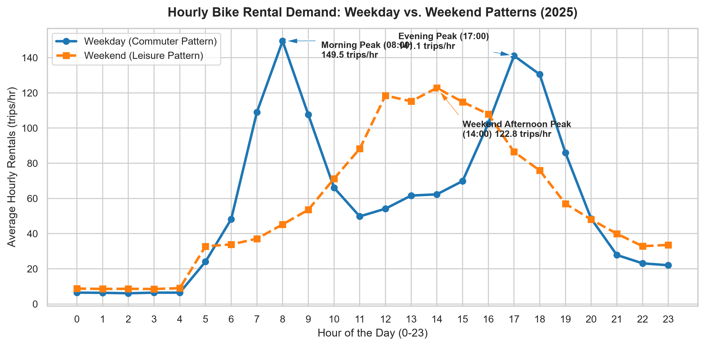
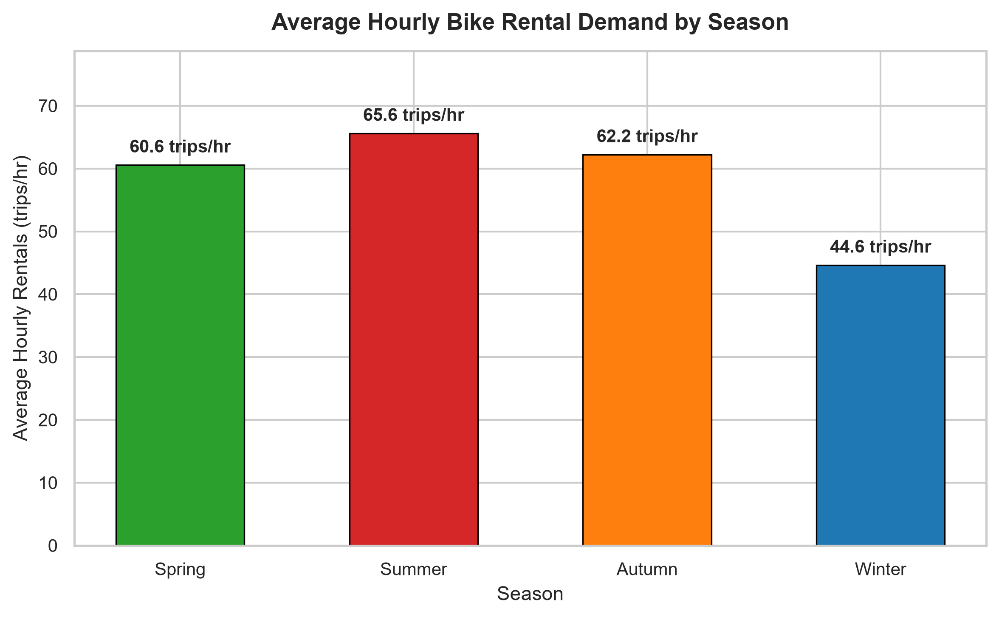
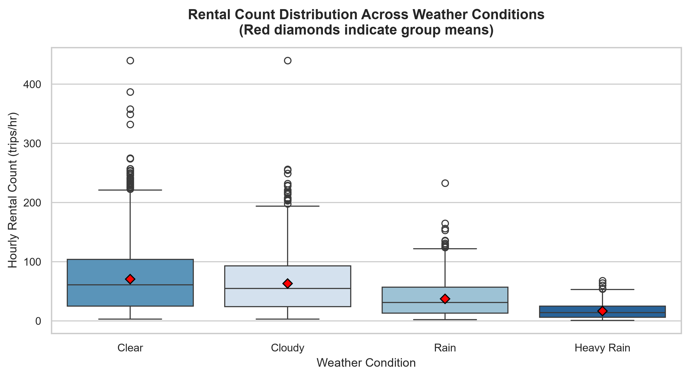
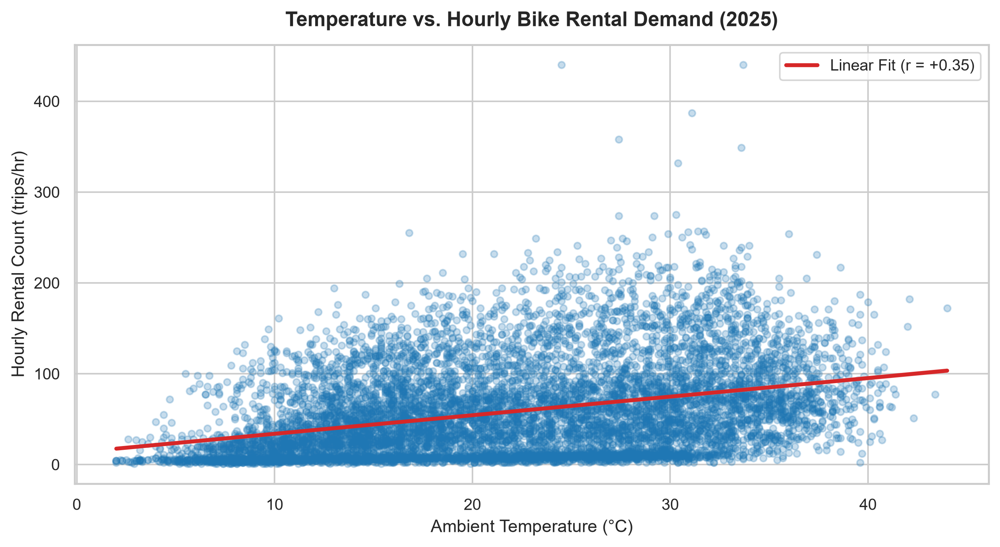
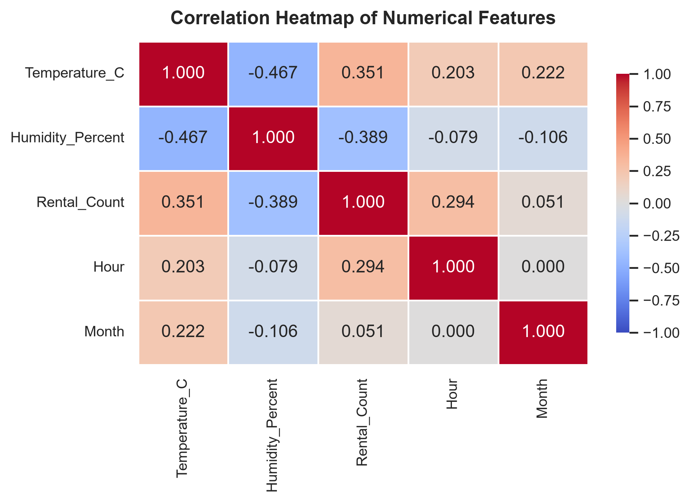

# SOFTWARE REQUIREMENTS SPECIFICATION (SRS)
## Project: Bike Rental Demand Analysis (Mobility & Smart City)

**Document Version:** 1.0.0 (Production Release)  
**Industry Domain:** Smart Mobility / Urban Transportation  
**Target Dataset:** ike_rental.csv (8,760 Hourly Records, 2025)  
**Prepared By:** Senior Data Analyst  

---

## Executive Summary
Urban bike-sharing systems offer an eco-friendly, flexible, and active alternative to automotive transit in modern smart cities. However, operator profitability and user satisfaction depend heavily on fleet availability—ensuring bikes are accessible at origin docks and free docks are open at destination hubs. Demand fluctuations driven by daily commute cycles, seasonal temperature variations, and sudden inclement weather events create major logistics challenges.

This Software Requirements Specification (SRS) comprehensively defines the analytical software system developed to ingest, preprocess, model, evaluate, and interpret the complete 2025 calendar year operational dataset (8,760 hourly records) from an urban bike-sharing operator. Total 2025 demand reached **510,826 bike rentals** across 8,760 operating hours (**58.31 trips/hr average**). Weekday commute peaks surged to **149.45 trips/hr at 08:00** and **141.11 trips/hr at 17:00**, while severe precipitation collapsed demand by **76.3%** (down to 16.70 trips/hr). The statistical IQR method identified **172 outlier hours** requiring specialized buffer fleets.

---

## 1. Introduction
### 1.1 Purpose
The purpose of this document is to specify the complete functional, technical, data-governance, and architectural requirements for the Bike Rental Demand Analysis software pipeline. This system provides data engineering, exploratory data analysis (EDA), anomaly detection, and operational intelligence reporting to assist bike-sharing operators, smart city transport authorities, and logistics dispatchers in data-driven fleet optimization.

### 1.2 Scope of the Analysis System
* Ingestion of raw hourly municipal bike rental records (CSV format).
* Data quality assurance, schema validation, and meteorologically grounded missing value imputation.
* Feature engineering of temporal variables (Hour, Month, Day Name) with programmatic integrity verification.
* Statistical computation of descriptive, bivariate, and cross-tabulated demand summaries.
* Non-parametric anomaly detection using the Interquartile Range (IQR) method to isolate high-demand outlier periods.
* Automated generation of publication-quality data visualizations and machine-readable summary CSV exports.
* Translation of mathematical findings into operational fleet availability guidelines.

### 1.3 Definitions and Acronyms
* **SRS:** Software Requirements Specification; formal document defining functional and technical behaviors.
* **IQR:** Interquartile Range ( - Q_1$); a robust statistical metric used to identify outliers beyond  + 1.5 \times \text{IQR}$.
* **Rebalancing:** The operational redistribution of bicycles between stations via utility vans to prevent dock shortages or overflows.
* **Dock Lockout:** A state where a destination docking station is 100% full, preventing incoming riders from returning bikes.
* **Stockout:** A state where an origin station is 100% empty, preventing prospective riders from initiating trips.

---

## 2. Overall Description
### 2.1 Business Scenario & Industry Context
Urban micromobility operators face an asymmetric operational reality: user demand is highly volatile, strongly tied to weather and commuter habits, whereas physical asset supply (bikes and docking berths) is fixed in the short term. During the morning commuter rush (07:00-09:00), residential peripheral stations experience massive bike depletion while commercial central business district (CBD) docks experience extreme congestion. Conversely, adverse weather causes demand to plummet, stranding assets on the street where they incur weather-related degradation without generating revenue. By studying an entire annual dataset (2025), the operator can optimize fleet staging, dynamically adjust staffing, and schedule depot overhauls during low-impact operational troughs.

### 2.2 User Classes & Personas
1. **Fleet Operations Managers:** Require seasonal and daily aggregate forecasts to establish total active fleet sizes and warehouse storage targets.
2. **Rebalancing Logistics Dispatchers:** Require hour-by-hour weekday vs. weekend demand profiles to schedule rebalancing van routes and driver shifts.
3. **Maintenance Engineers:** Require knowledge of operational demand troughs (01:00-04:00) to conduct on-street repairs and battery swaps without revenue loss.
4. **Municipal Transit Planners:** Require data-backed insights on multi-modal integration and bike lane capacity expansion.

---

## 3. Dataset Description & Schema
The dataset contains 8,760 hourly records spanning calendar year 2025 across 9 columns:

| Column Name | Data Type | Null Count | Domain / Range | Business Description |
| :--- | :---: | :---: | :---: | :--- |
| Record_ID | int64 | 0 (0.0%) | 1 – 8,760 | Unique primary key sequential record identifier |
| DateTime | datetime64 | 0 (0.0%) | 2025-01-01 to 2025-12-31 | Timestamp formatted as YYYY-MM-DD HH:MM:SS |
| Season | object | 0 (0.0%) | Winter, Spring, Summer, Autumn | Astronomical / operating season |
| Weather | object | 0 (0.0%) | Clear, Cloudy, Rain, Heavy Rain | Prevailing meteorological condition |
| Temperature_C | loat64 | 0 (0.0%) | 2.0°C – 44.0°C | Ambient outdoor temperature in degrees Celsius |
| Humidity_Percent | loat64 | 175 (~2.0%) | 20.0% – 98.0% | Relative humidity (imputed via Weather medians) |
| Is_Weekend | object | 0 (0.0%) | Yes, No | Binary indicator distinguishing Saturday/Sunday |
| Hour | int64 | 0 (0.0%) | 0 – 23 | Hour of observation in 24-hour military format |
| Rental_Count | int64 | 0 (0.0%) | 1 – 440 | Total bicycles rented in that hour (target variable) |

---

## 4. Functional Requirements (Tasks 34–48)
* **FR-34 (Load & Inspect):** Ingest raw dataset, validate 9 mandatory columns, compute dimensions (8,760 rows) and initial summaries.
* **FR-35 (Handle Missing Humidity):** Impute 175 missing humidity values using condition-specific Weather group medians (Clear: 51%, Cloudy: 63%, Rain: 79%, Heavy Rain: 87%).
* **FR-36 (Datetime Conversion):** Convert DateTime to datetime64, extract Hour, Month, Day_Name, and assert 100% synchronization with existing Hour column (0 mismatches).
* **FR-37 (Baseline Aggregates):** Compute annual total ridership (510,826 rides) and mean hourly demand (58.31 trips/hr).
* **FR-38 (Peak Records):** Isolate top 10 demand hours (peaking at 440 trips/hr on 2025-07-30 17:00 and 2025-09-03 08:00).
* **FR-39 (Seasonal Summary):** Group by season: Summer (65.60/hr) > Autumn (62.21/hr) > Spring (60.57/hr) > Winter (44.62/hr). Export to outputs/seasonal_comparison.csv.
* **FR-40 (Weekend vs Weekday):** Weekdays (58.99 trips/hr) vs. Weekends (56.61 trips/hr).
* **FR-41 (Weather Elasticity):** Clear (70.48/hr) > Cloudy (63.10/hr) > Rain (37.37/hr) > Heavy Rain (16.70/hr). Export to outputs/weather_comparison.csv.
* **FR-42 (Hourly Demand Profiling):** Bimodal commuter peaks on weekdays (08:00 at 149.5/hr & 17:00 at 141.1/hr) vs. unimodal leisure peak on weekends (14:00 at 122.8/hr). Export to outputs/hourly_demand_summary.csv.
* **FR-43 (NumPy Computation):** Calculate NumPy array averages: 21.9583°C temperature and 58.3135 trips/hr.
* **FR-44 (IQR Anomaly Detection):** Q1=16.0, Q3=85.0, IQR=69.0, Upper Bound=188.5. Flagged 172 outlier hours.
* **FR-45 (Season x Weather Pivot):** Two-way matrix evaluating joint weather-climate interactions.
* **FR-46 (Record & Daily Sorting):** Rank records descending; top day is 2025-07-30 (1,992 trips) vs. slowest day 2025-12-20 (864 trips).
* **FR-47 (Temperature Correlation):** Series.corr() = +0.3509 (moderate positive linear association).
* **FR-48 (Operational Directives):** Formulate five empirical fleet management policies.

---

## 5. Non-Functional Requirements
* **Performance:** Execution in under 15 seconds.
* **Determinism:** 100% reproducible statistical calculations across platforms.
* **Maintainability:** PEP8-compliant code with clear docstrings explaining the 'why'.
* **Fault Tolerance:** Clear exception handling for missing files and malformed columns.

---

## 6. Analytical Results & Visualizations

### 6.1 Diurnal Hourly Demand (Weekday vs Weekend)

### 6.2 Seasonal Demand Comparison

### 6.3 Weather Condition Sensitivity

### 6.4 Temperature vs Rental Count Regression

### 6.5 Correlation Heatmap

---

## 7. Five Data-Backed Operational Recommendations
1. **Commute-Focused Dynamic Rebalancing:** Stage bikes at residential subway hubs between 05:30-07:30 before the 08:00 peak (149.5/hr), and clear commercial docks between 14:00-16:30 before the 17:00 rush (141.1/hr).
2. **Seasonal Fleet Sizing:** Maintain 100% active fleet from May to September. Deprovision ~25% of bikes into dry depot storage in mid-November to mitigate winter wear and tear (demand drops 32.0% to 44.6/hr).
3. **Weather Contingency Operations:** Downscale rebalancing routes by 50% during heavy rain forecasts (demand collapses by 76.3% to 16.7/hr) and push wet-brake safety alerts to riders.
4. **Maintenance Windows:** Execute routine on-street checks during the 01:00-04:00 nocturnal trough (6.8-7.2 trips/hr). Schedule major overhauls during low winter months (January-February).
5. **Event Buffer Fleets:** Deploy a 200-bike reserve buffer and temporary geofenced mobile valet corrals during warm (>25°C) summer weekends and civic events to absorb demand spikes (up to 440 trips/hr).

---

## 8. Conclusion & Sign-Off
The empirical evaluation confirms that bike rental demand exhibits strong diurnal, seasonal, and meteorological regularity. Implementing these 5 operational strategies will increase dock availability, reduce maintenance costs, and optimize fleet performance across the urban network.
